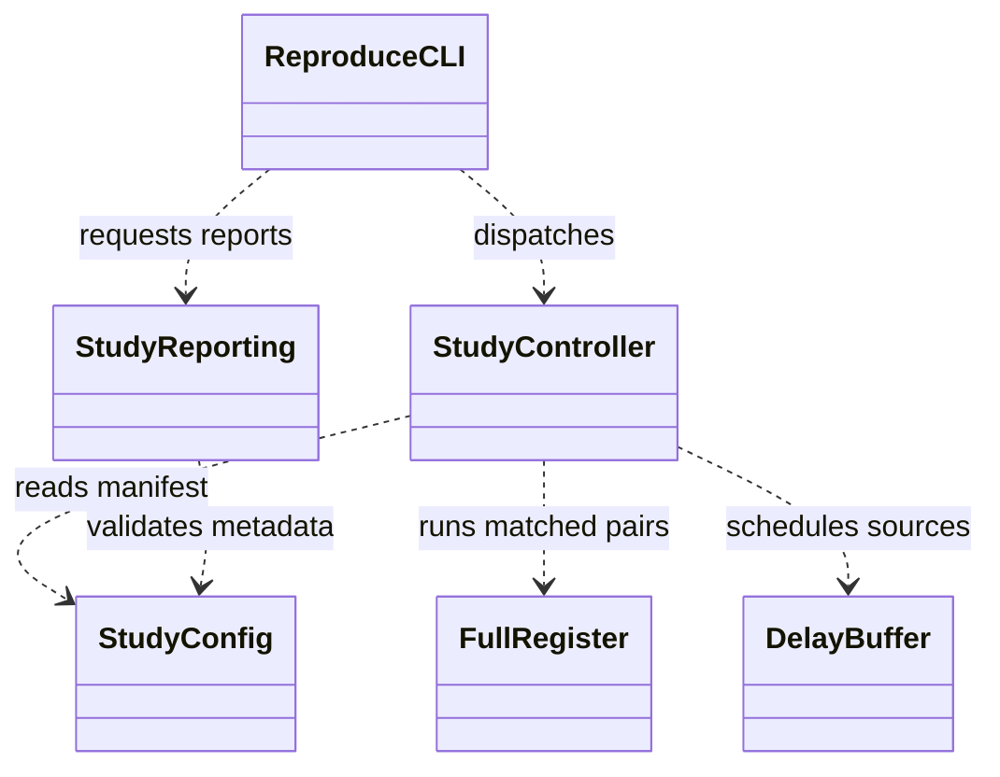

# EgTRQC: finite-register delayed-feedback benchmark

EgTRQC compares an explicit finite matter–geometry register with a matter-only
nonlinear GKSL-type closure on a six-qubit octahedral graph. It also provides
linear, graph, product-state, and dense reduced models. Feedback history is an
explicit object, observed without mutation and advanced once per physical step.

## Installation and verification

Use Python 3.11 or later:

```bash
python -m venv .venv
source .venv/bin/activate
python -m pip install -e '.[dev,docs]'
python -m pytest -q
python -m egtrqc.reproduce --study validate
python scripts/verify_files.py
python -m sphinx -W --keep-going -b html docs/source docs/_build/html
```

On Windows PowerShell, activate with `.venv\Scripts\Activate.ps1`.
`requirements-lock.txt` records the supplied numerical environment, with notebook
runtime dependencies removed; it is not a lock for every supported platform.

## Reproduce the studies

```bash
# Rebuild reports from the supplied trajectories.
python -m egtrqc.reproduce --study report
# Run or reuse every configured study and rebuild reports.
python -m egtrqc.reproduce --study all
# Recompute all trajectories (potentially expensive).
python -m egtrqc.reproduce --study all --recompute
# Select one study.
python -m egtrqc.reproduce --study active_refinement
```

The seven full-model studies cover frozen and active sources, short lags, nested
registers, robustness, long horizons, time refinement, and population refinement.
The supplied data contain 732 matched pairs (1,464 full-model trajectories) and
60 reduced topology trajectories. Repeated configurations across studies are
execution counts, not independent statistical samples. Folds are deterministic;
summaries use the mean and sample standard deviation over three folds.
Coherent geometry retains quadratic register blocks; the M=10,20,40 scaling
study uses pointer-classical geometry. See [protocols](PROTOCOLS.md) and the
[data dictionary](DATA_DICTIONARY.md) before comparing outputs.

The inherited reduced-model commands remain available:

```bash
python -m egtrqc.cli run-sweep --output-dir results/reference_sweep
python -m egtrqc.cli analyze-dense-delay --output-dir results/dense_delay_analysis
bash scripts/build_all.sh
```

The build script runs tests, reuses cached studies, validates outputs, and builds
Sphinx documentation. Pass `--recompute` to regenerate the integrated studies.

## Architecture and notebook migration

The package follows MVC responsibilities: physical models and configuration form
the model layer; the simulator, study controller, and CLIs coordinate execution;
reporting and analysis render stored outputs. Controllers may persist results,
but views do not schedule new physical trajectories.



Executable notebooks are removed. Their numerical definitions are available in
Python modules, their recorded MIME displays and PDF figures are preserved under
`results/legacy_reference/`, and their hashes are recorded in
`provenance/notebook_migration.json`. The original ZIP is the source archive.
`notebook_kernel.py` keeps its historical name and inherited class definitions
for compatibility and numerical equivalence; its legacy plotting and suite
helpers are documented as a compatibility boundary, not a fully separated MVC
implementation. New study execution lives outside that kernel.

## Repository layout

| Directory | Contents |
| --- | --- |
| `src/egtrqc/` | Physical models, source controllers, CLIs, diagnostics, reporting |
| `configs/` | Deterministic full-model study manifests |
| `results/` | Imported trajectories, summaries, tables, figures, historical displays |
| `artifacts/` | Earlier package-generated reduced-model reference outputs |
| `provenance/` | Input hashes, original release evidence, integration integrity manifest |
| `tests/` | Delay, numerical equivalence, model, and integration checks |
| `docs/source/` | English Sphinx guides, UML diagrams, and Google-style API documentation |

Build with `make -C docs html`; open `docs/_build/html/index.html`.
The published documentation is at <https://qc-upm.github.io/EgTRQC/>.
The `Documentation` GitHub Actions workflow builds Sphinx on pull requests and
publishes the generated HTML on pushes to `main` or manual runs. In repository
**Settings > Pages > Build and deployment**, select **GitHub Actions** as the
source. The `docs/source/` directory contains Sphinx sources and cannot be served
directly as the documentation site.
The UML guide includes package, class, sequence, activity, and artifact diagrams.
Scientific scope and the relation between historical and controlled protocols are
explained in [PROTOCOLS.md](PROTOCOLS.md).

## Citation and Zenodo

The existing repository archive is [10.5281/zenodo.23780997](https://doi.org/10.5281/zenodo.23780997).


**Release maintenance:** after GitHub and Zenodo publication, manually replace the
release DOI here and in the editable manuscript citation and data/code availability
statement. The supplied PDFs are reference documents; no editable manuscript
source was included and no new DOI or remote deposit is claimed.

The original GNU Affero General Public License, version 3, is retained in
[LICENSE](LICENSE). Original scientific authorship and citations are preserved.
